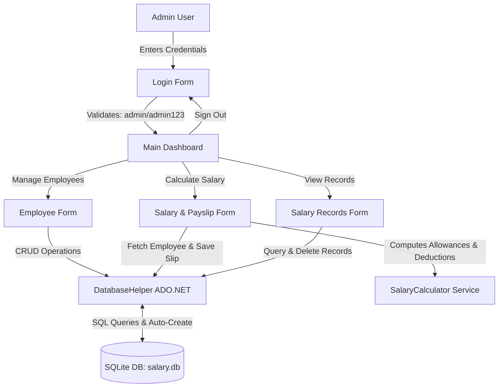

# Employee Salary Management and Payslip Generation System
> **College Mini Project | Department of Computer Science & Engineering / Information Technology**  
> **Technology Stack:** C#, .NET Framework 4.8, Windows Forms (WinForms), SQLite Database, ADO.NET

---

## 1. Project Title
**Employee Salary Management and Payslip Generation System**

---

## 2. Problem Statement
In many small-to-medium organizations, educational institutes, and offices, employee salaries and payroll computations are performed manually using spreadsheets or physical ledgers. Manual salary processing has several critical problems:
- Frequent calculation mistakes in statutory allowances (HRA, DA) and statutory deductions (PF, Tax).
- High administrative time consumption each month.
- Lack of data validation leading to duplicate employee records and inconsistent salary inputs.
- Difficulty in retrieving historical salary records for audits or dispute resolution.
- Inconvenience in generating professional, standardized payslips for employees.

---

## 3. Existing System vs. Proposed System

| Feature / Aspect | Existing System (Manual / Excel) | Proposed System (WinForms + SQLite) |
| :--- | :--- | :--- |
| **Data Storage** | Loose paper registers or standalone Excel sheets | Relational SQLite embedded database (`salary.db`) |
| **Calculations** | Manual calculations prone to human error | 100% automated calculation using standard formulas |
| **Validation** | Weak or no input validation; allows negative amounts | Strict validation (empty checks, numeric checks, unique ID) |
| **Security** | Open to anyone who accesses the file or ledger | Secure administrator login authentication |
| **Payslip Generation** | Handwritten or individually drafted slips | One-click standardized payslip generation & printing |
| **Search & Retrieval**| Tedious manual search across files | Instant search by Employee ID or Employee Name |
| **Data Redundancy** | Duplicate IDs and conflicting records common | Unique Primary Key enforcement prevents duplicates |

---

## 4. Objectives
- To automate employee record management (Create, Read, Update, Delete).
- To automate monthly payroll calculations with standard allowance and deduction rules.
- To eliminate manual calculation errors in Gross Salary, PF, Tax, and Net Salary.
- To provide a professional, printable and exportable salary slip (payslip).
- To maintain an audit trail of all generated salary records in an embedded SQLite database.
- To design a clean, user-friendly, and intuitive Windows desktop application suitable for academic demonstration.

---

## 5. Key Features
1. **Admin Login Authentication:** Simple and secure login mechanism (`admin` / `admin123`) to prevent unauthorized access.
2. **Dashboard Overview:** Displays live operational metrics (Total Employees, Total Salary Records Generated) and quick navigation cards.
3. **Employee Details Management (CRUD):**
   - Register new employees with unique IDs.
   - Update existing employee details.
   - Delete employee records with confirmation.
   - Interactive table view with instant search filter.
4. **Automated Salary Calculation:**
   - House Rent Allowance (HRA) = 20% of Basic Salary
   - Dearness Allowance (DA) = 10% of Basic Salary
   - Gross Salary = Basic Salary + HRA + DA
   - Provident Fund (PF) = 8% of Basic Salary
   - Income Tax = 5% of Basic Salary
   - Total Deductions = PF + Tax
   - Net Salary = Gross Salary - Total Deductions
5. **Payslip Generation & Export:**
   - Real-time preview of formatted salary slips.
   - One-click print/print-preview with formatting.
   - Export salary slips to `.txt` files for digital distribution.
6. **Salary Records History:**
   - DataGridView showing all processed salaries.
   - Instant search by Employee ID or Name.
   - Summary of total payouts.
   - Record deletion and slip re-generation.

---

## 6. Technologies Used
- **Programming Language:** C# (.NET Framework 4.8 / Visual Studio 2017/2019/2022)
- **User Interface (UI):** Windows Forms (WinForms) with custom card styling and Segoe UI fonts
- **Database:** SQLite embedded database (`salary.db`)
- **Data Access:** ADO.NET (`System.Data.SQLite`) with parameterized queries to prevent SQL Injection
- **Reporting & Printing:** Standard .NET `PrintDocument` and `PrintPreviewDialog`

---

## 7. System Requirements

### Hardware Requirements
- **Processor:** Intel Core i3 or higher / AMD equivalent
- **RAM:** Minimum 2 GB (4 GB recommended)
- **Hard Disk Space:** Minimum 100 MB free storage
- **Display Resolution:** 1280 × 720 or higher

### Software Requirements
- **Operating System:** Windows 10 / Windows 11 / Windows 8.1 / Windows 7 SP1
- **Runtime Environment:** Microsoft .NET Framework 4.5 or higher (pre-installed on Windows 10/11)
- **Development Tool:** Visual Studio 2017, 2019, or 2022 (Community / Professional / Enterprise)

---

## 8. Modules Description

```
┌──────────────────────────────────────────────────────────────────────────┐
│              EMPLOYEE SALARY MANAGEMENT & PAYSLIP SYSTEM                 │
└──────────────────────────────────────────────────────────────────────────┘
       │                 │                     │                  │
┌──────────────┐  ┌──────────────┐      ┌──────────────┐   ┌──────────────┐
│ Login Module │  │  Dashboard   │      │ Employee Mgt │   │ Salary Calc  │
│  admin/admin │  │ Live Metrics │      │ CRUD Records │   │ HRA, DA, PF, │
└──────────────┘  └──────────────┘      └──────────────┘   │ Tax, Gross & │
                                                           │ Net Salary   │
                                                           └──────────────┘
                                                                  │
                                                           ┌──────────────┐
                                                           │ Payslip & DB │
                                                           │ Print & Save │
                                                           └──────────────┘
```

1. **Authentication Module (`LoginForm.cs`):** Validates administrator credentials before granting access to dashboard features.
2. **Dashboard Module (`DashboardForm.cs`):** Central command screen presenting project overview, live database statistics, calculation rules, and one-click navigation to all forms.
3. **Employee Management Module (`EmployeeForm.cs`):** Handles employee registration and database persistence with full validation against empty fields, negative salaries, and duplicate IDs.
4. **Salary Calculation Module (`SalaryForm.cs`):** Retrieves employee details, calculates statutory allowances and deductions, and generates formatted company payslips.
5. **Salary History Module (`RecordsForm.cs`):** Displays audit records in a tabular format, provides search filters, and allows administrators to reprint or delete past records.
6. **Data Access Layer (`DatabaseHelper.cs`):** Encapsulates all SQLite connection lifecycles, table creations, parameterized SQL queries, and seed data.
7. **Business Logic Layer (`SalaryCalculator.cs`):** Pure calculation engine with zero UI dependencies, ensuring testability and separation of concerns.

---

## 9. System Architecture



---

## 10. Database Design

### Table 1: `Employees`
Stores master information for each employee.

| Column Name | Data Type | Constraints | Description |
| :--- | :--- | :--- | :--- |
| `EmployeeId` | `TEXT` | `PRIMARY KEY` | Unique Employee Identifier (e.g., EMP101) |
| `Name` | `TEXT` | `NOT NULL` | Full Name of the employee |
| `Department` | `TEXT` | `NOT NULL` | Assigned department (IT, HR, Finance, etc.) |
| `Designation`| `TEXT` | `NOT NULL` | Job role/title (e.g., Senior Developer) |
| `BasicSalary`| `REAL` | `NOT NULL` | Monthly basic pay amount in INR (₹) |

### Table 2: `SalaryRecords`
Stores historical salary computations and generated payslips.

| Column Name | Data Type | Constraints | Description |
| :--- | :--- | :--- | :--- |
| `Id` | `INTEGER` | `PRIMARY KEY AUTOINCREMENT` | Auto-incrementing record ID |
| `EmployeeId` | `TEXT` | `NOT NULL, FK -> Employees` | Foreign key referencing the employee |
| `BasicSalary`| `REAL` | `NOT NULL` | Base salary at the time of calculation |
| `HRA` | `REAL` | `NOT NULL` | House Rent Allowance (20%) |
| `DA` | `REAL` | `NOT NULL` | Dearness Allowance (10%) |
| `GrossSalary`| `REAL` | `NOT NULL` | Gross earnings = Basic + HRA + DA |
| `PF` | `REAL` | `NOT NULL` | Provident Fund deduction (8%) |
| `Tax` | `REAL` | `NOT NULL` | Income Tax deduction (5%) |
| `TotalDeduction` | `REAL` | `NOT NULL` | Total deductions = PF + Tax |
| `NetSalary` | `REAL` | `NOT NULL` | Final payable salary = Gross - Total Deduction |
| `SalaryDate` | `TEXT` | `NOT NULL` | Date of calculation (YYYY-MM-DD) |

---

## 11. Salary Calculation Formula & Numerical Example

### Mathematical Formula:
1. **House Rent Allowance (HRA):**  
   $$\text{HRA} = \text{Basic Salary} \times 20\% = \text{Basic Salary} \times 0.20$$
2. **Dearness Allowance (DA):**  
   $$\text{DA} = \text{Basic Salary} \times 10\% = \text{Basic Salary} \times 0.10$$
3. **Gross Salary:**  
   $$\text{Gross Salary} = \text{Basic Salary} + \text{HRA} + \text{DA}$$
4. **Provident Fund (PF):**  
   $$\text{PF} = \text{Basic Salary} \times 8\% = \text{Basic Salary} \times 0.08$$
5. **Income Tax (Tax):**  
   $$\text{Tax} = \text{Basic Salary} \times 5\% = \text{Basic Salary} \times 0.05$$
6. **Total Deduction:**  
   $$\text{Total Deduction} = \text{PF} + \text{Tax}$$
7. **Net Salary:**  
   $$\text{Net Salary} = \text{Gross Salary} - \text{Total Deduction}$$

---

### Step-by-Step Numerical Example:
Assume an employee has a **Basic Salary of ₹30,000**:

```
1. Basic Salary     = ₹30,000.00
2. HRA (20%)        = 30,000 × 0.20 = ₹6,000.00
3. DA (10%)         = 30,000 × 0.10 = ₹3,000.00
--------------------------------------------------
4. GROSS SALARY     = 30,000 + 6,000 + 3,000 = ₹39,000.00

5. PF (8%)          = 30,000 × 0.08 = ₹2,400.00
6. Tax (5%)         = 30,000 × 0.05 = ₹1,500.00
--------------------------------------------------
7. TOTAL DEDUCTIONS = 2,400 + 1,500 = ₹3,900.00

8. NET SALARY       = Gross Salary - Total Deductions
                    = 39,000 - 3,900 = ₹35,100.00
```

---

## 12. Implementation Details

### Project Folder Structure:
```
EmployeeSalaryManagement/
│
├── EmployeeSalaryManagement.sln       # Visual Studio Solution File
├── EmployeeSalaryManagement.csproj    # C# Project File
├── App.config                         # .NET runtime config
├── packages.config                    # NuGet package references
│
├── Models/
│   ├── Employee.cs                    # Employee data entity
│   └── SalaryRecord.cs                # Salary record data entity
│
├── Services/
│   └── SalaryCalculator.cs            # Pure calculation & formatting logic
│
├── Data/
│   └── DatabaseHelper.cs              # SQLite connection & ADO.NET CRUD methods
│
├── Forms/
│   ├── LoginForm.cs                   # Admin login screen
│   ├── DashboardForm.cs               # Main dashboard with cards & stats
│   ├── EmployeeForm.cs                # Employee CRUD interface with DataGridView
│   ├── SalaryForm.cs                  # Salary calculation & payslip preview/print
│   └── RecordsForm.cs                 # Salary history table with search & delete
│
├── Database/
│   └── salary.db                      # SQLite database file (auto-created)
│
├── packages/                          # Pre-bundled SQLite assemblies
│   └── Stub.System.Data.SQLite.Core.NetFramework.1.0.119.0/
│
├── Program.cs                         # Application entry point
└── README.md                          # Project documentation
```

---

## 13. Testing and Test Cases

| Test Case ID | Test Scenario | Input Data | Expected Result | Actual Result | Status |
| :--- | :--- | :--- | :--- | :--- | :--- |
| **TC-01** | Add new employee with valid details | ID: `EMP105`, Name: `Kiran Rao`, Dept: `IT`, Desig: `Tester`, Basic: `32000` | Employee saved successfully; table refreshed | Saved to SQLite and row added to table | **PASS** |
| **TC-02** | Validation on empty employee name | ID: `EMP106`, Name: `""`, Dept: `HR`, Desig: `Executive`, Basic: `25000` | Warning: "Employee Name cannot be empty" | Validation dialog displayed; record blocked | **PASS** |
| **TC-03** | Validation on negative or zero basic salary | ID: `EMP107`, Name: `Sunil`, Dept: `Finance`, Basic: `-5000` | Warning: "Basic Salary must be a valid positive number" | Validation dialog displayed; record blocked | **PASS** |
| **TC-04** | Verify salary calculation accuracy | Basic Salary: `₹30,000` | HRA: `6000`, DA: `3000`, Gross: `39000`, PF: `2400`, Tax: `1500`, Deductions: `3900`, Net: `35100` | Exact values computed and shown on UI | **PASS** |
| **TC-05** | Attempt to insert duplicate Employee ID | ID: `EMP101` (already exists in DB) | Error: "Employee ID already exists" | Duplicate check detects ID; insert aborted | **PASS** |
| **TC-06** | View saved salary record in history | Compute & Save salary for `EMP102` | Record appears in `RecordsForm` DataGridView; search works | Record visible with correct Net Salary | **PASS** |

---

## 14. How to Run in Visual Studio (Step-by-Step)

Follow these steps to open and run the project in Visual Studio:

1. **Launch Visual Studio:**  
   Open Visual Studio 2017, 2019, or 2022 on your machine.
2. **Open Solution:**  
   Click on **File** → **Open** → **Project/Solution...**  
   Navigate to the project folder:  
   `EmployeeSalaryManagement\EmployeeSalaryManagement.sln`  
   and click **Open**.
3. **Verify References:**  
   In the **Solution Explorer** window on the right, expand `References`.  
   Ensure that `System.Data.SQLite` and `System.Windows.Forms` are loaded properly without warning triangles.
4. **Build the Solution:**  
   Press `Ctrl + Shift + B` (or click **Build** → **Build Solution** in the top menu).  
   Verify that the Output window shows: `Build: 1 succeeded, 0 failed`.
5. **Run the Application:**  
   Press `F5` (or click the green **Start** button on the toolbar).
6. **Log in:**  
   Use the default administrator credentials:  
   - **Username:** `admin`  
   - **Password:** `admin123`  
   Click **Sign In**.
7. **Test Features:**  
   - Add a new employee in **Add & Manage Employee**.  
   - Open **Calculate Salary & Payslip**, select the employee, and click **Calculate Salary**.  
   - Click **Save Record to Database** and **Print / Preview Payslip**.  
   - Open **Salary Records History** to view, search, or export the saved record.

---

## 15. 10 Viva Questions and Answers (Mini Project Viva Preparation)

### Q1: What is the main objective of this project?
**Answer:** The main objective is to automate employee data management and monthly salary calculations, eliminate manual mathematical errors in allowances and deductions, store records securely in an SQLite database, and generate standardized printable payslips.

### Q2: Which software architecture pattern does this project follow?
**Answer:** The project follows a **3-Tier (Layered) Architecture**:
1. **Presentation Layer (UI):** Windows Forms (`LoginForm`, `DashboardForm`, `EmployeeForm`, `SalaryForm`, `RecordsForm`).
2. **Business Logic Layer (BLL):** `SalaryCalculator.cs` which computes allowances, gross pay, deductions, and net pay.
3. **Data Access Layer (DAL):** `DatabaseHelper.cs` which manages SQLite connection and executes CRUD operations.

### Q3: Why did you choose SQLite instead of SQL Server or MySQL?
**Answer:** SQLite is a serverless, zero-configuration, self-contained embedded database engine. It stores the entire database in a single file (`salary.db`) right beside the application, eliminating the need to install or configure external database servers like MySQL or SQL Server on the lab or evaluation machine.

### Q4: How is SQL Injection prevented in this project?
**Answer:** In `DatabaseHelper.cs`, we strictly use **parameterized queries** (`cmd.Parameters.AddWithValue("@Id", ...)`) rather than string concatenation for SQL queries. This ensures all user inputs are treated as literal data values and cannot alter the SQL command structure.

### Q5: What formulas are used to calculate Gross and Net Salary?
**Answer:**
- **Gross Salary** = $\text{Basic Salary} + \text{HRA (20\%)} + \text{DA (10\%)}$
- **Total Deductions** = $\text{PF (8\%)} + \text{Tax (5\%)}$
- **Net Salary** = $\text{Gross Salary} - \text{Total Deductions}$

### Q6: How does the application prevent duplicate employee records?
**Answer:** 
1. In the database, the `EmployeeId` column is declared as a `PRIMARY KEY`, which inherently enforces uniqueness at the database level.
2. In the application layer, before inserting a new employee, the method `DatabaseHelper.IsEmployeeIdExists(empId)` is called to check if the ID is already registered, and alerts the user if a duplicate is found.

### Q7: What validation checks are implemented for employee details?
**Answer:**
- **Empty Field Checks:** Employee ID, Name, and Designation cannot be left empty or contain only whitespace.
- **Data Type & Range Validation:** Basic Salary must be a valid positive number (`> 0`) parsed using `decimal.TryParse`.
- **Friendly Alerts:** Informative `MessageBox` dialogs guide the user to correct invalid entries.

### Q8: How does the payslip printing functionality work in C# WinForms?
**Answer:** It uses the built-in .NET `System.Drawing.Printing.PrintDocument` class combined with `PrintPreviewDialog`. In the `PrintPage` event handler, the formatted payslip string is drawn onto the graphics surface using `ev.Graphics.DrawString()` with a monospace font (`Consolas`).

### Q9: What happens if the database file `salary.db` is deleted or does not exist?
**Answer:** When `Program.cs` runs, it invokes `DatabaseHelper.InitializeDatabase()`. The method uses `CREATE TABLE IF NOT EXISTS` commands to automatically recreate the database file, define the schema for `Employees` and `SalaryRecords`, and seed standard sample employees so the system never crashes.

### Q10: What are the advantages of using Windows Forms (WinForms) for this desktop project?
**Answer:** WinForms provides a rapid application development (RAD) environment with rich native Windows controls (DataGridView, DateTimePicker, ComboBox), excellent desktop responsiveness, offline capability, and seamless integration with the .NET Framework without requiring internet connectivity.

---

## 16. Future Enhancements
- **Attendance & Leave Integration:** Automatically deduct salary based on unpaid leaves or late check-ins.
- **Role-Based Access Control:** Distinct roles for HR Admin, Payroll Officer, and Employees (self-service portal).
- **PDF Export:** Export payslips directly to PDF with company logo images using libraries like iTextSharp or PDFsharp.
- **Email Dispatch:** Automatically email monthly salary slips to employees' registered email addresses.
- **Overtime & Bonus Management:** Add dynamic bonus and overtime calculation rules.

---

## 17. Conclusion
The **Employee Salary Management and Payslip Generation System** successfully simplifies and automates payroll operations for an organization. By integrating C# Windows Forms with an embedded SQLite database, the system ensures high calculation precision, prevents data duplication, secures payroll records, and produces professional payslips. The clean code organization, robust input validation, and self-contained database architecture make it an ideal, dependable, and easily explainable college mini-project.
